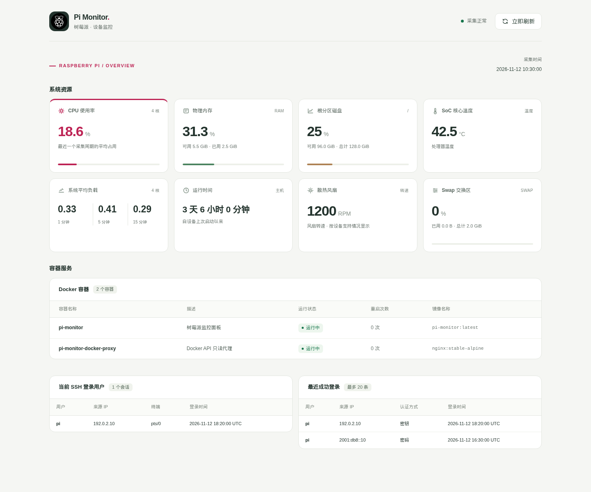

# Pi Monitor

轻量树莓派监控面板，使用 FastAPI、Jinja2 和 Docker 部署。在一个页面查看主机资源、容器状态及 SSH 登录信息。



## 功能

- **主机资源**：CPU、内存、Swap、根分区容量、系统负载、运行时间。
- **硬件传感器**：SoC 温度、风扇转速；设备不支持时显示暂无数据。
- **Docker 容器**：名称、用途描述、运行状态、重启次数和镜像名称。
- **SSH 登录**：当前登录用户、来源地址、终端，以及最近 20 条成功登录记录。
- **后台采集**：默认每 10 秒采集一次，最新结果保存在内存中。
- **局部刷新**：页面定时或手动读取缓存，保留页面布局，不重复触发硬件采集。

## 环境要求

- Linux 宿主机，推荐使用 Raspberry Pi OS / Debian。
- Docker Engine 和 Docker Compose v2。
- 启用 SSH 登录监控时，宿主机需要 Python 3、systemd、`loginctl` 和 `journalctl`。

CPU、内存和磁盘监控也可以在其他 Linux 主机上使用。温度及风扇数据取决于设备提供的传感器接口。

## 快速开始

```bash
git clone https://github.com/626-Legendary/pi-monitor.git
cd pi-monitor
docker compose up -d --build
```

浏览器访问 `http://树莓派IP:8888`。

首次采集完成前会显示等待提示；没有启用 SSH 采集服务时，其他监控功能可以正常使用。

### 配置端口与采集周期

```bash
cp .env.example .env
```

按需修改 `.env`：

```dotenv
MONITOR_BIND_ADDRESS=0.0.0.0
MONITOR_PORT=8888
SAMPLE_INTERVAL_SECONDS=10
```

| 配置 | 默认值 | 说明 |
| --- | --- | --- |
| `MONITOR_BIND_ADDRESS` | `0.0.0.0` | 监听地址。仅通过本机反向代理访问时可改为 `127.0.0.1` |
| `MONITOR_PORT` | `8888` | 对外访问端口 |
| `SAMPLE_INTERVAL_SECONDS` | `10` | 后台采集周期，允许 1～3600 秒 |

修改后执行 `docker compose up -d`，Compose 会应用新的配置。修改应用代码后使用 `docker compose up -d --build`。

## 启用 SSH 登录监控

在树莓派宿主机、项目目录中执行：

```bash
sudo sh host/install.sh
docker compose up -d --build
```

安装脚本会创建专用非 root 系统用户 `pi-monitor-ssh`，安装并启用 `pi-monitor-ssh.service`。

- 当前会话每 10 秒更新，来自 systemd-logind。
- 最近成功登录每分钟更新，来自 sshd / sshd-session 的系统日志。
- 采集结果写入 `/run/pi-monitor-ssh/ssh.json`，监控容器只读访问该目录。
- 默认 `/run` 是内存文件系统，采集快照不写入 SD 卡；原有系统认证日志的存储方式由宿主机决定。

历史记录取自最近 30 天、最多 2000 条仍保留的 SSH 日志，展示其中最新的 20 条成功认证记录。日志已清理或系统未记录相关事件时，无法补回这些记录。当前登录会话不等同于全部 SSH TCP 连接，例如纯端口转发可能不创建登录会话。

详细安装、排查和卸载说明见 [host/README.md](host/README.md)。

## 设置容器用途描述

在需要监控的每个服务的 Compose 配置中添加 `description` 标签：

```yaml
services:
  your-service:
    image: your-image:latest
    labels:
      description: "这个容器的用途"
```

已有 `labels` 时追加这一项，保留原有标签。在该服务所属的 Compose 项目目录执行：

```bash
docker compose up -d
```

仅执行 `docker compose restart` 不会应用标签变更。未填写描述的容器显示“未填写”。

## 部署结构

```text
浏览器 ──→ FastAPI ──→ 内存中的最新采集结果
                      ↑
               后台采集线程（默认 10 秒）
                 ├─ 主机指标和传感器
                 ├─ Docker 只读代理 ──→ Docker socket
                 └─ SSH 快照文件 ←── 宿主机只读采集服务
```

`docker-proxy` 使用 Nginx 转发 Unix socket 请求，不提供网页，也不监听 TCP。只允许 GET 查询 Docker 版本、容器列表和容器详情，拒绝其他接口及所有写操作。

监控应用以 UID/GID `10001` 运行，使用只读文件系统并移除 Linux capabilities。应用不直接挂载 Docker socket，不共享宿主机 PID 或网络，也不挂载整个宿主机根目录。

宿主机 `/etc/hostname` 作为根分区容量统计的文件锚点。如果 `/etc` 位于独立分区，请将 Compose 中该挂载源替换为实际位于根分区上的普通文件。

页面和 API 当前没有内置登录验证。请在可信网络中访问；远程访问时配置带身份验证的反向代理。SSH 用户名和来源地址也会显示在面板中。

## 常用命令

```bash
# 更新代码及镜像
git pull --ff-only
docker compose up -d --build

# 查看应用与代理日志
docker compose logs -f --tail=100

# 停止 / 恢复
docker compose stop
docker compose up -d

# 移除容器与网络，保留镜像及命名卷
docker compose down
```

更新宿主机 SSH 采集脚本后，重新运行 `sudo sh host/install.sh`。

## 常见问题

### “立即刷新”为什么数值没变？

按钮立即读取后台缓存，不额外触发采集。系统指标默认每 10 秒更新，SSH 历史记录每分钟更新。

### 系统平均负载是百分比吗？

不是。它是 1、5、15 分钟内正在运行或等待 CPU，以及处于不可中断等待状态的平均任务数。对于 4 核设备，持续接近 4 的 CPU 型负载通常意味着 CPU 比较繁忙；还应结合 CPU 使用率和 I/O 情况判断。

### 出现数据过期或连接异常？

先查看 `docker compose logs --tail=100 pi-monitor`。界面会分别提示网络请求失败、后台采集失败和缓存过期。应用更新后重新加载网页，以使用最新的刷新脚本。

### 没有温度、风扇或 SSH 数据？

硬件传感器需要对应型号和接口支持。SSH 区域显示未连接时检查宿主机采集服务；显示读取失败或数据过期时按 [SSH 排查说明](host/README.md) 检查权限、日志与服务状态。

## 本地开发与测试

应用需要 Python 3.11 或更高版本：

```bash
python3 -m venv .venv
. .venv/bin/activate
python -m pip install -r requirements-dev.txt
python -m pytest
```

安装 Node.js 22 或更新版本后，测试还会验证页面自动刷新、手动刷新、断连重试和时间偏差处理；没有 Node.js 时仅跳过这项前端回归测试。Node.js 不是运行监控服务的依赖。

```bash
# 本地启动：保持单进程，避免重复采集
uvicorn main:app --host 127.0.0.1 --port 8888 --workers 1
```

Docker 配置提供完整的代理与挂载。本地直接启动未配置代理或 SSH 快照时，页面会提示对应数据不可用。

GitHub Actions 会在 Python 3.11 / 3.13 上运行测试、检查 Compose 和 shell 脚本，并构建 Docker 镜像、检查代理配置。CI 不部署服务或发布镜像。

## API

| 路径 | 说明 |
| --- | --- |
| `GET /` | 监控页面 |
| `GET /api/metrics` | 最新缓存数据及页面更新片段 |
| `GET /assets/raspberry-pi.png` | 页面 Logo |
| `GET /assets/favicon.svg` | 网站图标 |

`/api/metrics` 在首次采集完成前返回 `503`，完成后返回 `200`；请求不会触发采集。页面和指标响应使用 `Cache-Control: no-store`。没有单独的 `/health` 接口。

## 项目结构

```text
main.py                    FastAPI、后台采集及缓存
templates/                 页面与局部更新模板
host/                      可选的宿主机 SSH 采集服务
tests/                     后端、SSH 解析及前端刷新回归测试
docs/preview.png           使用示例数据生成的界面预览
docker-compose.yml         监控应用与 Docker 只读代理
Dockerfile                 监控应用镜像
docker-proxy.conf          Docker API 允许访问的接口
.env.example               部署配置示例
.github/workflows/ci.yml   自动检查
```
